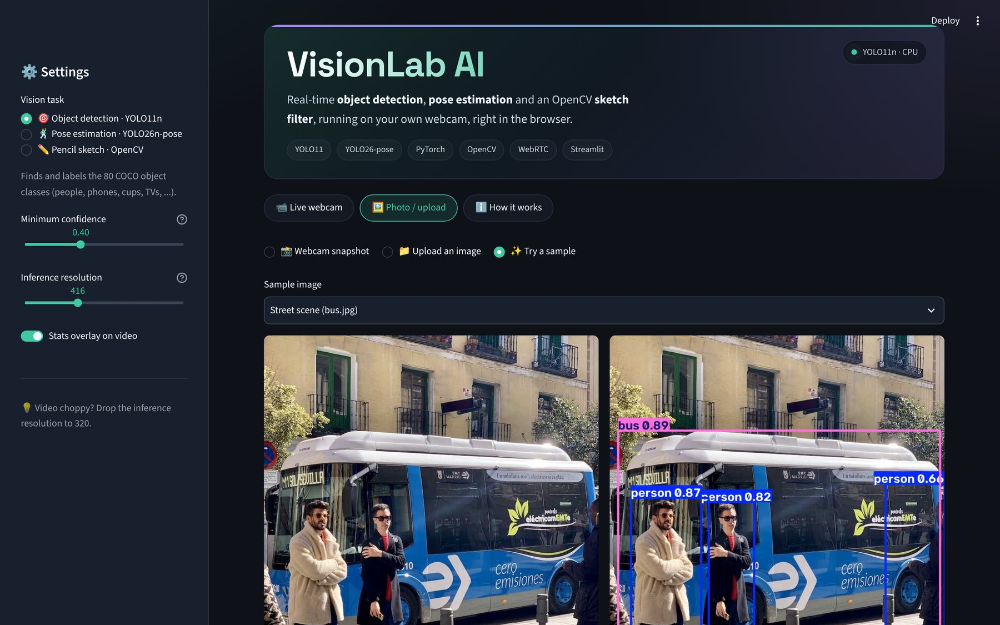
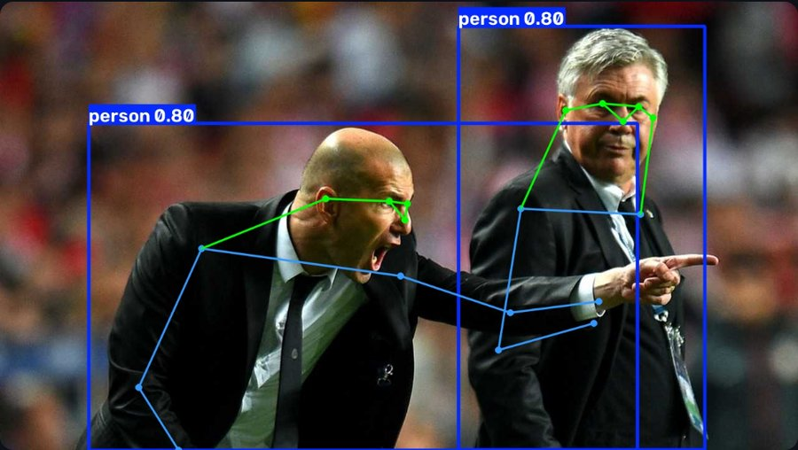
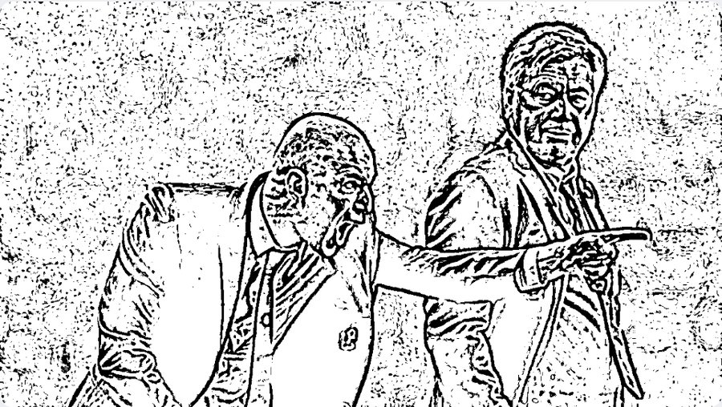
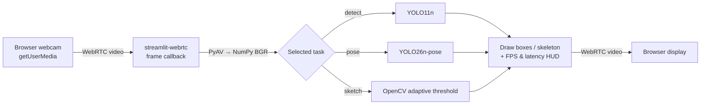

<div align="center">

# 🎥 VisionLab AI

**Real-time object detection and human pose estimation, running on your own webcam, in the browser.**

[](https://visionlab-ai.streamlit.app)

**[▶ Try the live demo](https://visionlab-ai.streamlit.app)**: no install, just allow camera access.

[](https://github.com/AliAbdulHameed/VisionLabAI/actions/workflows/ci.yml)


[](LICENSE)



</div>

## Overview

VisionLab AI is a Streamlit web app that streams a visitor's webcam to a Python backend over **WebRTC**, runs a computer vision model on every frame, and streams the annotated video back in real time. No install is needed on the visitor's side: [open the live demo](https://visionlab-ai.streamlit.app), click **Start camera**, and allow camera access.

The project started as a set of Jupyter experiments with OpenCV video processing, MoveNet and YOLO pose estimation, and local webcam detection. I turned the techniques that worked best into an interactive, deployable app that anyone can use.

## Features

| | |
|---|---|
| 📹 **Live webcam inference** | Browser camera → WebRTC → model → annotated stream, side by side with a live readout of FPS, inference time and the objects in view, colour-keyed to their boxes |
| 🎯 **Object detection** | YOLO11n, pretrained on COCO (80 classes: people, phones, laptops, cups, TVs…) |
| 🕺 **Pose estimation** | YOLO26n-pose: 17 body keypoints and a skeleton for every person in the frame |
| ✏️ **Pencil-sketch filter** | Classic OpenCV pipeline (grayscale → median blur → adaptive threshold), no neural network |
| 🖼️ **Photo mode** | Analyze a webcam snapshot, an uploaded image or a built-in sample. See a per-class detection table with confidence and download the annotated result |
| 🎛️ **Live controls** | Switch tasks and tune the confidence threshold and inference resolution *while the stream is running*, with per-task tips for what to try |
| 🎞️ **Smooth video on a CPU** | The model runs off the video thread on the newest frame, so the stream plays at camera speed while detections refresh as fast as the model allows |
| ⚡ **Lean, fast inference** | The models run on OpenVINO with a small NumPy pipeline: no PyTorch at runtime, 3× less memory and 3–4× faster CPU inference, at a capped 15 detections/s to stay within free-tier CPU limits |
| 🔒 **Privacy-minded** | Frames are processed in memory and never written to disk or recorded |

<table>
<tr>
<td></td>
<td></td>
</tr>
<tr>
<td align="center"><b>Pose estimation (YOLO26n-pose)</b></td>
<td align="center"><b>Pencil sketch (OpenCV)</b></td>
</tr>
</table>

## How it works



- **Streaming:** [`streamlit-webrtc`](https://github.com/whitphx/streamlit-webrtc) handles the peer connection. Each incoming `av.VideoFrame` goes to a callback on a worker thread, and the callback returns the processed frame.
- **Non-blocking video:** the frame callback never waits for the model. It hands a copy of the newest frame to a background worker and immediately redraws the latest finished detections onto the current frame. Frames that arrive while the model is busy replace the pending one, so there's no backlog and boxes are at most one inference behind.
- **No PyTorch at runtime:** the Ultralytics models are exported once to OpenVINO IR (FP16 weights, dynamic input shapes) and committed to `models/`. The app runs them with its own pre/post-processing (letterbox, confidence filter, class-aware NMS, coordinate rescaling, drawing) that mirrors Ultralytics' predictor. Across 128 combinations of image, resolution and confidence threshold it finds the same objects as Ultralytics, with identical coordinates when given the same input. Dropping PyTorch cut the install from several GB to under 1 GB and memory to about a third.
- **CPU budget:** free hosting throttles apps that use too much CPU. The model runs on one thread (extra threads cut ~4 ms of latency but nearly double CPU per detection, and the worker already hides latency from the video) and at most 15 times a second. Video still plays at full camera rate; boxes refresh every ~67 ms. Together this roughly halves the server's CPU use per viewer.
- **Shared, thread-safe models:** each model loads once with `st.cache_resource`, warms up on a dummy frame, and is shared by all visitors behind a lock.
- **Live settings:** Streamlit reruns the script when a slider changes, and `streamlit-webrtc` swaps in the new frame callback. The running stream picks up the new settings without reconnecting.
- **Live dashboard:** the frame callback publishes FPS, latency and per-class counts to a lock-protected `LiveStats` object. A Streamlit fragment re-renders only the stats panel twice a second, so the rest of the page and the video stream are untouched.
- **Separation of concerns:** UI code lives in `app.py`. The vision logic in `visionlab/` is plain Python and is unit tested without a browser or GPU.

## Project structure

```
VisionLabAI/
├── app.py                  # Streamlit app: sidebar, live/photo/about tabs
├── visionlab/
│   ├── tasks.py            # Task registry (labels, descriptions, model folders)
│   ├── inference.py        # OpenVINO YOLO engine: letterbox, NMS, rescaling
│   ├── draw.py             # Boxes, labels and pose skeletons
│   ├── background.py       # Non-blocking, latest-frame-wins inference worker
│   ├── filters.py          # OpenCV pencil-sketch filter
│   ├── overlay.py          # FPS meter, label summaries, HUD drawing
│   ├── live.py             # Thread-safe stats hand-off from video thread to UI
│   ├── ui.py               # HTML components (title, live readout, steps)
│   └── style.css           # Custom theme and layout
├── tests/                  # pytest unit tests (run in GitHub Actions)
├── .streamlit/config.toml  # Theme
├── models/                 # YOLO11n and YOLO26n-pose as OpenVINO IR (FP16)
├── assets/samples/         # Demo images for the Photo tab
├── scripts/export_models.py  # Regenerates models/ from Ultralytics weights
├── requirements.txt        # Runtime dependencies (no PyTorch)
└── requirements-dev.txt    # + pytest, ruff
```

## Run it locally

**Requirements:** Python 3.10–3.12 and a webcam. The models (~6 MB each) are included in the repo.

```bash
git clone https://github.com/AliAbdulHameed/VisionLabAI.git
cd VisionLabAI
python -m venv .venv
source .venv/bin/activate        # Windows: .venv\Scripts\activate
pip install -r requirements.txt
streamlit run app.py
```

<details>
<summary>Using Anaconda instead</summary>

```bash
conda create -n visionlab python=3.11 -y
conda activate visionlab
pip install -r requirements.txt
streamlit run app.py
```
</details>

Open the URL Streamlit prints (usually <http://localhost:8501>), go to **Live webcam**, click **START** and allow camera access.

> **Changing models:** `pip install ultralytics openvino`, edit `scripts/export_models.py`, and run it to regenerate `models/`. Only this script needs PyTorch.

### Tests and linting

```bash
pip install -r requirements-dev.txt
ruff check .
pytest
```

## Deploy

The app is ready for [Streamlit Community Cloud](https://streamlit.io/cloud) (free):

1. Sign in with GitHub, click **Create app**, and select this repository with `app.py` as the entry point.
2. Under **Advanced settings**, choose Python 3.11 or 3.12.
3. Deploy. `requirements.txt` is installed automatically.

**WebRTC and TURN:** Live video needs a direct peer connection between the visitor and the server. Many cloud hosts and corporate/mobile networks block that, so the **Photo / upload** tab is the reliable fallback. For dependable live video, add a TURN relay. Get free credentials from [Cloudflare Realtime TURN](https://developers.cloudflare.com/realtime/turn/), then add them in your app's **Settings → Secrets**:

```toml
CLOUDFLARE_TURN_KEY_ID = "..."
CLOUDFLARE_TURN_KEY_API_TOKEN = "..."
```

`streamlit-webrtc` detects these environment variables and configures the ICE servers automatically. Never commit keys to the repository. See the [streamlit-webrtc deployment guide](https://github.com/whitphx/streamlit-webrtc#network-configuration) for details.

**Performance:** Free hosting is CPU-only, shared and memory-limited. Measured locally with YOLO11n at 416 px and a 20 fps test camera, inside a container limited to a 1-CPU quota:

| | Original (PyTorch, blocking) | Current (OpenVINO, non-blocking, no PyTorch) |
|---|---|---|
| Inference latency | 87–426 ms | ~16 ms |
| Frames shown in the browser | 10–12 fps | ~20 fps (the camera's maximum) |
| Server memory, steady state | ~1,165 MB | ~560 MB |
| Install size | several GB (PyTorch + CUDA libraries) | under 1 GB |

## Roadmap

- [ ] Multi-object tracking with persistent IDs (ByteTrack)
- [ ] Video-file upload with downloadable annotated output
- [ ] Rep counting / joint-angle measurement from pose keypoints
- [ ] Class filter (e.g. detect only `person` and `cell phone`)
- [ ] ONNX / OpenVINO export for faster CPU inference

## Acknowledgements and licensing

- Models and inference: [Ultralytics YOLO](https://github.com/ultralytics/ultralytics). The YOLO11 and YOLO26 weights are pretrained by Ultralytics on the [COCO](https://cocodataset.org/) dataset. This project integrates and deploys them; it does not retrain them.
- Streaming: [streamlit-webrtc](https://github.com/whitphx/streamlit-webrtc) by Yuichiro Tachibana.
- Sample images (`bus.jpg`, `zidane.jpg`) are from the Ultralytics project.

The code in this repository is released under the [MIT License](LICENSE). Ultralytics YOLO is licensed under [AGPL-3.0](https://www.ultralytics.com/license), which applies to any deployment that uses it. Review those terms before using this project commercially.
